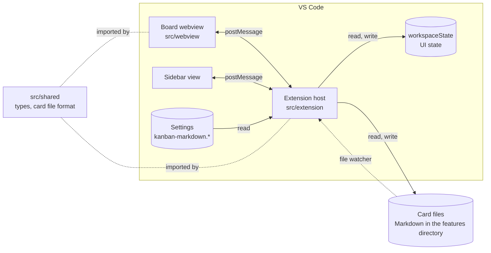

[README](../README.md) › Architecture

# Architecture

What goes here, and what goes in an area doc instead, is under [Architecture doc](CLAUDE.md#architecture-doc).

## Goals and constraints

- Show a folder of Markdown files as a Kanban board inside VS Code, and write every change back to those files, so the cards stay plain text in git.
- No server and no database: the files are the state. A user can edit a card in any editor, and the board follows.
- Stays close enough to upstream that syncs stay cheap; upstream PRs are a nice-to-have, not a constraint on design ([Upstream](git-workflow.md#upstream)).
- The extension host and the webview are separate bundles that only talk by messages.
- UI strings exist in en, es and pt.

## Building blocks

- **Extension** (`src/extension/`): runs in the VS Code host, built with esbuild into `dist/extension.js`. It registers the commands and views, reads and writes the card files, watches the folder, and keeps UI state in `workspaceState`. `KanbanPanel.ts` holds the message handling.
- **Webview** (`src/webview/`): React 18, Zustand and Tailwind, built with Vite. It renders the board, handles drag and drop, and hosts the card editor.
- **Shared** (`src/shared/`): the types and small utilities both sides use, including the message types (`types.ts`) and the card file parser and serializer (`featureFrontmatter.ts`). Imports are relative and it has no DOM, since the integration tests compile it without the `@/` alias.

The host and the webview talk through `postMessage`; `src/shared/types.ts` is the contract.

- [Extension](areas/extension.md): loading, moving and writing cards, the messages, file watching.
- The webview's area doc is still to come (see the card `area-docs-baseline` in [backlog](../backlog/)).

## Decisions

- **Fractional-indexing `order` per column.** Each card has an `order` key from the `fractional-indexing` package. A move generates a key between the new neighbours, so only the moved card's file changes.
- **Fixed frontmatter plus Markdown.** A card is one file: a fixed set of frontmatter fields, then the Markdown body. The parser reads those fields and the serializer writes them back in a fixed order, so unknown fields aren't kept. The parser reads the fields with regexes; it is not a YAML parser.

## Risks

- `_moveFeature` has no unit tests, and the order logic reaches across the extension and the webview.
- A move computes its key from the cards in the target column, without looking at the epic lane, so a drop in an epic lane can land in the wrong place.
- Two cards with equal `order` keys make a move throw; the error is not shown to the user.
- The serializer drops unknown frontmatter fields, so a card edited on the board can lose fields added by hand.