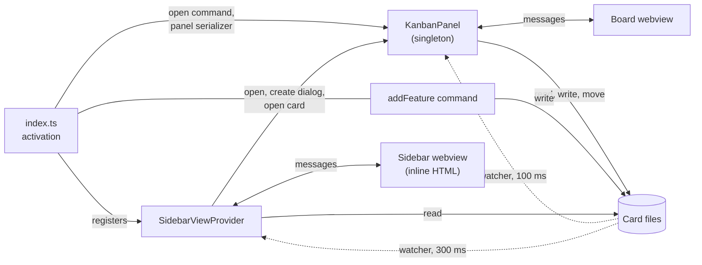
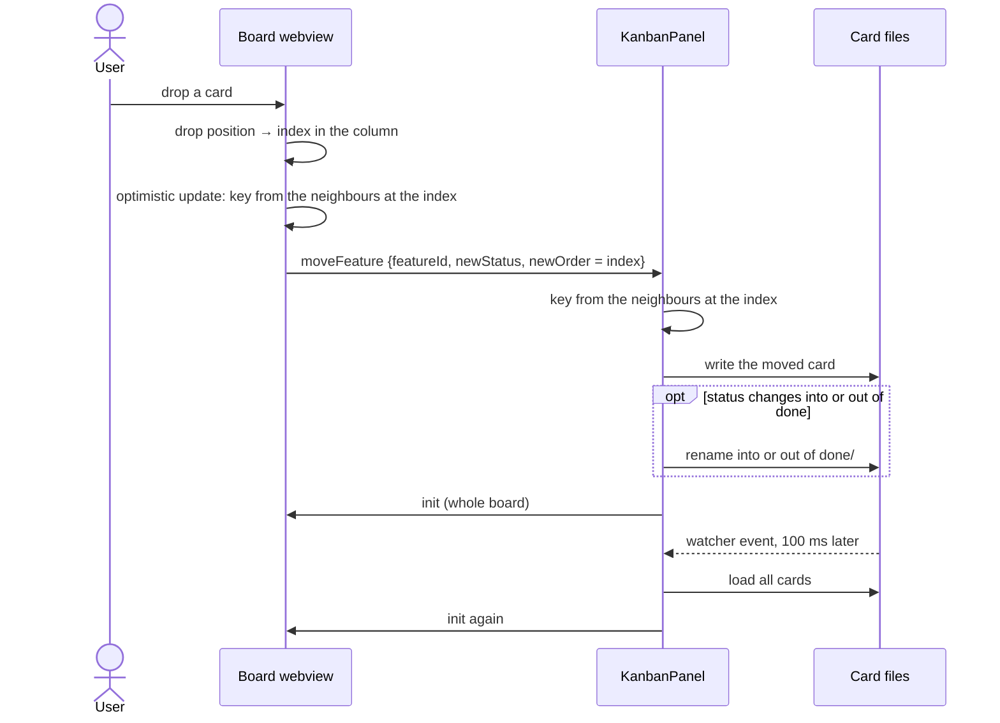
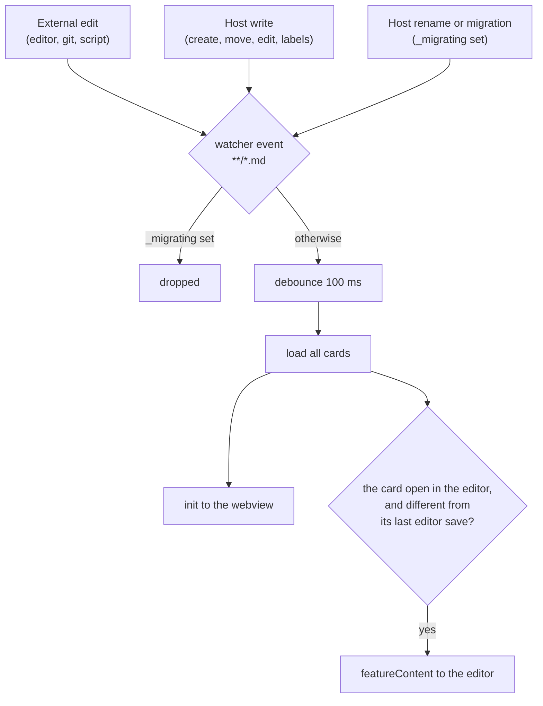

[README](../../README.md) › [Architecture](../architecture.md#building-blocks) › Extension

# Extension

The extension host owns the card files: it loads them into the board, turns the webview's messages into file writes, and follows changes to the folder. How it sits next to the webview is in [Building blocks](../architecture.md#building-blocks), the card file format in [Decisions](../architecture.md#decisions).

## Concepts

- **Features directory.** `kanban-markdown.featuresDirectory` under the first workspace folder. In a multi-root workspace the other folders are ignored.
- **Card file.** One Markdown file per card. Open cards lie flat in the directory, `done` cards in `done/`, archived ones in `archived/`. The status is read from the frontmatter; the folder only mirrors whether a card is done.
- **Card id.** The frontmatter `id`, falling back to the filename. It is the filename when a card is created, but the two can drift apart: a name clash on a move adds a suffix to the file only, and a file renamed outside the extension keeps its old `id`.
- **The board in memory.** `KanbanPanel` holds the parsed cards. Every load rebuilds them from disk, and every message to the webview is built from them.
- **Columns.** The `columns` setting; a card's `status` is a column id. Statuses aren't checked against it, so a card whose status names no column is loaded but has no column to show in.
- **UI state.** Collapsed columns, collapsed epic lanes and the view mode (standard or epic) live in `workspaceState`, per workspace, not in the files.

## Parts

- `KanbanPanel` is the board. Opening it again only reveals the open one; after a window reload the serializer restores it. All loading, migrating and writing for the board happens here.
- The sidebar shows the counts per column and the in-progress cards. It reads the card files itself, with its own smaller frontmatter parser and its own watcher, and writes nothing. It opens the board whenever it becomes visible, and reaches the panel through `KanbanPanel.currentPanel`; for "new card" and "open card" it waits a fixed 500 ms for the board to be ready.
- The `addFeature` command (command palette) writes a card without the panel: it ignores `filenamePattern`, `addNewCardsToTop` and name clashes.
- `FeatureHeaderProvider.ts` and `src/shared/editorTypes.ts` aren't wired up: nothing registers the provider, no view is contributed and no webview entry is built for it.

## Messages

The contract is `src/shared/types.ts`.

- **Host to webview.** `init` carries the whole state: cards, columns, display settings, UI state, locale and translations. It is the only message that updates the board, and it is sent again in full after every change. `featureContent` fills the card editor, `triggerCreateDialog` opens the create dialog.
- **Webview to host.** `ready` starts the first load; the webview gets no state before it. After that: card operations (create, move, update, delete, the editor's save), bulk operations (move all, archive all, rename or delete a label), UI state, and hand-offs to VS Code (open the file, open the settings, start an AI agent in a terminal).

Edge rules:

- The host's handler isn't typed against the contract, and the two have drifted: `focusMenuBar` and `startWithAI` are handled but not declared; `featuresUpdated` is declared and handled by the webview but never sent.
- Unknown message types are ignored. No operation catches its errors, so a failed write shows nothing to the user.

## Loading

A load runs on `ready`, on every watcher event and after a filename migration. It:

1. creates the directory and `done/` if missing;
2. moves cards out of the old per-status folders (`backlog/`, `todo/`, `in-progress/`, `review/`) into the root or `done/`;
3. reads the `.md` files in the root and in `done/`; it doesn't recurse, so `archived/` and other subfolders are never loaded;
4. moves each card whose folder doesn't match its status;
5. turns integer `order` values into fractional keys, rewriting every card of the columns that have one;
6. sorts by `order`, as plain string comparison.

Edge rules:

- Steps 2, 4 and 5 run on every load, including those triggered by the watcher, so a load can itself write and move files.
- A file without a `---` frontmatter block is skipped without a message. An error anywhere else in the load leaves an empty board, also without a message.
- A missing `order` is read as `a0`; a missing `created` or `modified` as the time of reading, so it changes on each load until the card is written.

## Moving a card

- The message carries an insert index, not a key, despite the field name `newOrder`. Both sides turn the index into a key with `computeMoveOrder` (`src/shared/order.ts`): the target column without the moved card, sorted by `order`, then `generateKeyBetween` of the two neighbours at the index. The webview uses its key for the optimistic update; the host's `init` replaces it.
- The webview computes the index from what the user sees, mapped onto the column without filters ([Drag and drop](webview.md#drag-and-drop)). In the epic view that index is counted within the lane, but both the optimistic update and the host apply it to the whole column across all lanes. That is the mechanism behind the epic-lane risk under [Risks](../architecture.md#risks).
- Dropping a card on another epic lane does nothing: each lane is a board of its own with its own drag state, so a drag can't change a card's epic.
- Only the moved card's file is written. `modified` is set on every move, also a reorder within one column; `completedAt` is set on a move into `done`, cleared on a move out of it, and kept otherwise.
- A move into or out of `done` renames the file into or out of `done/`, with `-1`, `-2` on a name clash; the `id` stays.
- Where the equal-keys error from [Risks](../architecture.md#risks) lands: in the webview it is thrown before the message is sent, so the drop is lost; in the host it is thrown after the card was changed in memory but before the write, so the board and the file differ until the next load.

Bulk moves:

- **Move all** sends a column's cards, or one lane's in the epic view, to the end of the target column, keeping their order. The webview waits for the host's `init` instead of updating optimistically.
- **Archive all** is offered on the `done` column only. After a confirmation, the files move to `archived/` unchanged. Since that folder isn't loaded, the cards leave the board; bringing one back means moving its file back by hand.

## File watching

- The watcher covers every `.md` file under the directory, `archived/` included. Each event, after the debounce, means a full load and an `init`.
- The host doesn't tell its own writes from external ones in general. It sets `_migrating` around renames and migrations, and the watcher drops events while it is set. Plain writes aren't covered, so each one is followed by a second load and `init` about 100 ms after the host's own `init`. This is harmless because the load reads back what was just written.
- Events while `_migrating` is set are dropped, not deferred: an external edit that lands in that window shows only with the next event.
- The editor check compares against the content of the last save from the board's own card editor. Only that save sets it, so any other change to the open card, such as a drag or a label rename, also counts as external and reloads the editor.

## Other writes

- **Create.** The filename comes from the title and `filenamePattern`, with `-1`, `-2` on a clash, and becomes the `id`. The key puts the card at the end of its column, or at the top with `addNewCardsToTop`.
- **Editor save.** Writes the body and the editable fields (status, priority, assignee, epic, due date, labels); `id`, `order` and `created` from the webview are ignored. `updateFeature` instead merges whatever fields the webview sends.
- **Delete.** Deletes the file, not into the trash.
- **Labels.** There is no list of labels; they exist only in the cards. Renaming or deleting one rewrites every card that has it.
- **`markdownEditorMode`.** Opens a card in a text editor instead of the board's card editor.
- **Settings changes.** A new `featuresDirectory` re-creates the watcher and reloads. A new `filenamePattern` offers to rename the existing files, from each card's title and `created` date. A new `language` reloads the translations and, if every column still has a default name, offers to rename the columns into the new language. Any other change resends `init`.

## Decisions

- **Status in the frontmatter, `done/` the only folder.** The status is read from the frontmatter, and the folder follows it; only `done` cards get a folder of their own. Every load migrates the earlier layout with one folder per status, so changing the layout again means another migration of every board's files.

## Where to start reading

- `src/extension/index.ts`: activation, the two commands, the panel serializer.
- `src/extension/KanbanPanel.ts`: the message switch in the constructor, then `_loadFeatures`, `_moveFeature`, `_setupFileWatcher` and `_sendFeaturesToWebview`.
- `src/shared/types.ts`: the messages in both directions.
- `src/shared/featureFrontmatter.ts`: reading and writing a card file.
- `src/extension/featureFileUtils.ts`: card file paths and the move into or out of `done/`.
