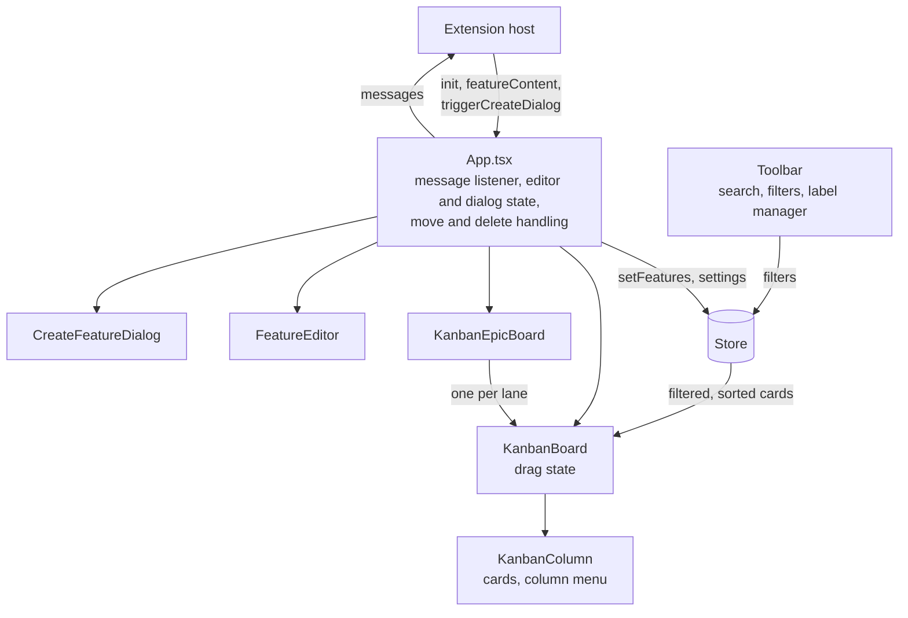
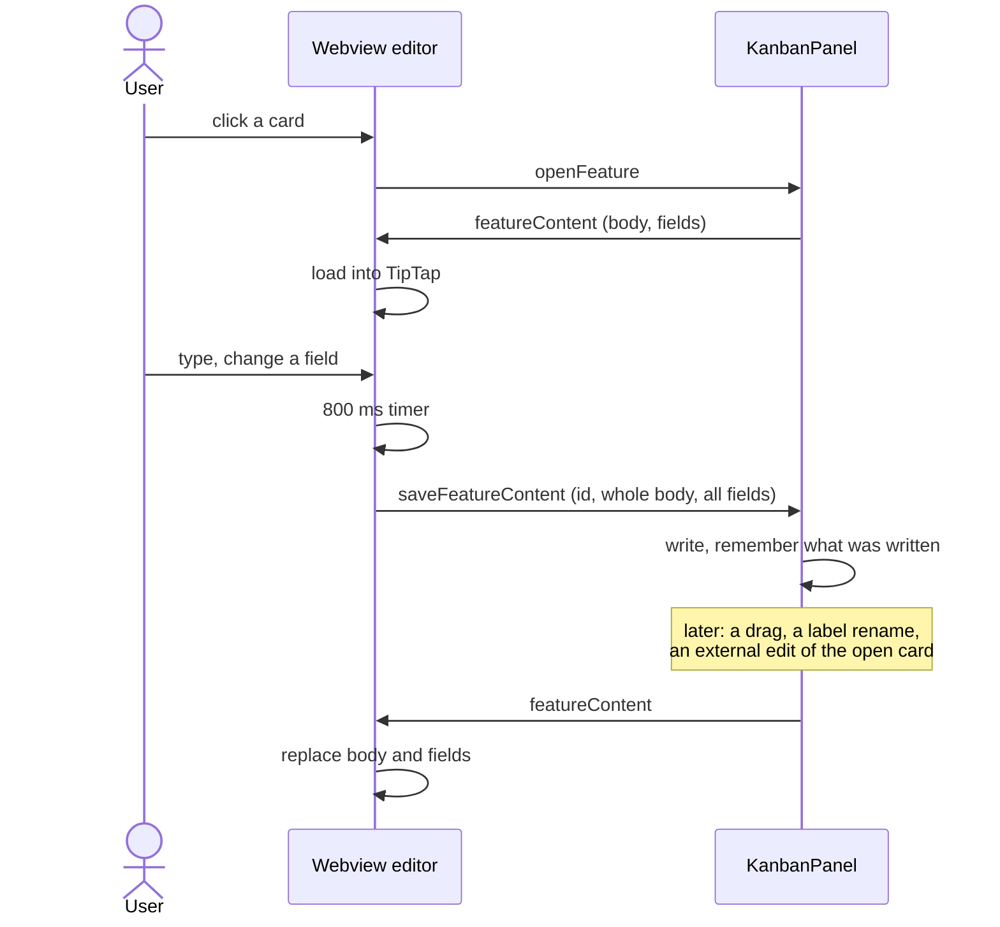

[README](../../README.md) › [Architecture](../architecture.md#building-blocks) › Webview

# Webview

The webview draws the board and the card editor. It holds a copy of the board that the host replaces with every `init`, and turns what the user does into messages. How it sits next to the host is in [Building blocks](../architecture.md#building-blocks); the messages, the move as a whole and the file watcher are in [Extension](extension.md).

## Concepts

- **The store.** One Zustand store (`store/index.ts`). Part of it comes from the host: cards, columns, display settings, locale, collapsed columns and lanes, view mode. Every `init` replaces that part whole. The rest belongs to the webview: search, filters and the horizontal or vertical layout. The panel keeps its context while hidden, so these survive switching tabs, but nothing stores them, so a reload resets them.
- **Columns.** The `columns` setting, drawn in the order the host sends. A card belongs to the column whose id equals its `status`; a card whose status names no column is drawn nowhere, yet it still counts in an epic lane's total and feeds the toolbar's assignee, label and epic lists.
- **Order.** The webview sorts each column itself, by `order` as a plain string comparison, the same rule the host uses. The sort runs in the store's selectors on every render; nothing is cached.
- **Epic lanes.** In the epic view each epic is a lane: the trimmed epic names in alphabetical order (case-sensitive), then a "no epic" lane if any card has none. Each lane is a whole board narrowed to that epic. Collapsed columns are shared by all lanes.
- **UI state.** Collapsing a column or lane and switching the view mode change the store at once and tell the host, which keeps them in `workspaceState` and sends them back in the next `init`. The host's copy is the one that counts.

## Parts

- `App.tsx` is the only place that listens to the host. It also owns what isn't in the store: the open card of the editor, the create dialog and the pending deletes.
- The boards and the column menus post some messages themselves (collapse, move all, archive all), and so does the label manager.
- The board components read the cards through selector functions, not by subscribing to `features`; they redraw because `App` subscribes to the whole store and redraws with every change.
- `QuickAddInput.tsx` and `PrioritySelect.tsx` aren't used anywhere.

## Optimistic updates

| Action | In the webview before the host answers | After |
| --- | --- | --- |
| Move a card | new status and a key from the neighbours | the next `init` replaces it |
| Delete | card removed; the message waits 5 s (see [Deleting](#deleting)) | |
| Collapse, view mode | store changed | the next `init` replaces it |
| Create, editor save, move all, archive all, labels | nothing | the next `init` |

There is no rollback. Since the host shows no error (see [Messages](extension.md#messages)), a move whose write failed stays where the user dropped it until the next `init` arrives.

## Drag and drop

Native HTML5 drag and drop, no library. The dragged card and the drop target are React state of one `KanbanBoard`; the card id put into `dataTransfer` is never read. How the index becomes a key, and what the host does with it, is in [Moving a card](extension.md#moving-a-card).

The drop index:

1. Hovering over a card sets the target: before it in its upper half, after it in its lower half, counted in the column as it is drawn, with filters applied.
2. A drop anywhere else in the column, or on a collapsed column, has no target of its own: the card goes after the last visible card.
3. Within the same column, a downward move counts one less, since the dragged card is still in the list. A drop on its own position sends nothing.
4. The visible index is mapped onto the column without filters: the card lands just before the visible card at that index, or just after the last visible card. Hidden cards keep their place around it.

Edge rules:

- Leaving a column doesn't clear the target. A drop in the gap below the cards of a column it was over before uses that old position instead of the end.
- The no-op check in step 3 compares visible positions only, so with a filter on, a drop that changes nothing can still send a move, and the host sets `modified`.
- Each epic lane is its own `KanbanBoard`, with its own drag state. A drop on another lane finds no dragged card and does nothing, though the cursor shows the drop as allowed. The index is counted within the lane; the rest of that is under [Moving a card](extension.md#moving-a-card).
- The insert position uses only the vertical mouse position, also in the vertical layout, where a column's cards wrap into rows.
- There is no keyboard way to move a card. Cards can't be focused, and the "move all" submenu opens on hover only.

Column menu:

- **Move all** and **Archive all** act on every card of the column, also those hidden by a filter; the header count shows only the visible ones. In an epic lane, move all stays within the lane, but archive all sends no lane and archives the whole `done` column.
- **Archive all** is offered on the column with the id `done` only.

## Filters and search

Search and the filters (priority, assignee, label, due date) are applied in one store selector, `getFilteredFeaturesByStatus`. Search is a case-insensitive substring match over the body (title included), id, assignee, epic and labels.

- An open column shows the filtered count; a collapsed column shows the count without filters.
- A filter stays set when the display setting that shows its control is turned off. The control is gone but the filter still hides cards; only "clear filters" removes it.
- A filter on a label or assignee that no longer exists hides every card.

## Deleting

A delete, from a card or from the editor, removes the card from the store at once and shows an undo toast for 5 s; only when the toast runs out is `deleteFeature` sent. Undo (the button, or Ctrl/Cmd+Z while a toast is shown) puts the card back in the store, and the host never hears of it.

- Closing or reloading the board within the 5 s drops the delete, so the card stays.
- An `init` within the 5 s brings the card back on the board while its toast still runs; the delete is still sent when the toast runs out. Undo at that point adds the card a second time, until the next `init`.
- Only deletes can be undone.

## Card editor

- The editor is TipTap with `StarterKit` and `tiptap-markdown`. The host sends only the body; the frontmatter goes as separate fields. A save re-serialises the whole body, so the file can change in places the user didn't touch.
- There is no save button. A save goes 800 ms after the last change to the body or a field, or at once with Ctrl/Cmd+S or Esc (Esc also closes). The close button, "open file" and delete don't save, so changes from the last 800 ms are lost.
- Every `featureContent` replaces the body and the fields in the editor, with no check for unsaved changes. Changes made since the last save are lost, along with the cursor and the undo history. When the host sends one is under [File watching](extension.md#file-watching). Clicking the open card again also asks for it.
- A timer still pending when new content arrives is not cancelled. A pending field change then writes its old fields back, which can undo the status a drag just set.
- The editor stays mounted when another card is opened, and the timer keeps the save for the card it was started on. Opening card B within 800 ms of an edit to card A loads B, then saves B's body and fields into A's file.
- A card with an empty body is not loaded: the editor keeps the previous card's text.
- The editor isn't closed when its card leaves the board (deleted or archived elsewhere). The host ignores saves for a card it doesn't have, so edits made after that are lost without a message.
- The status list is the five default statuses, not the `columns` setting.

## Creating a card

- The create dialog opens from a column's "+", with that column's status; from the `n` key or the host's `triggerCreateDialog` (the sidebar's "new card"), always with `backlog`, so the `defaultStatus` setting is never used. In the epic view, the "+" doesn't preset the lane's epic.
- Closing the dialog creates the card: Esc, the close button, a click beside it, Ctrl/Cmd+Enter and Ctrl/Cmd+S all submit. Only an empty title and description create nothing.
- The new card shows with the host's `init`; it isn't opened in the editor.

## Localisation

The host sends the translation bundle for the chosen language in every `init`, and `lib/i18n.ts` hands it to `@vscode/l10n`. Keys are ids such as `editor.addLabels`, not English text. Before the first `init` there is no bundle, so the loading screen shows the key. The language falls back per bundle file, not per key. The `locale` in the store is used only to format dates.

## Where to start reading

- `src/webview/App.tsx`: the message listener, `handleMoveFeature`, the delete and undo handling, which component shows when.
- `src/webview/store/index.ts`: the state, the selectors that sort and filter.
- `src/webview/components/KanbanBoard.tsx`: the drag state and `handleDrop`.
- `src/webview/components/KanbanEpicBoard.tsx`: the lanes.
- `src/webview/components/FeatureEditor.tsx`: the TipTap setup and the save timers.
